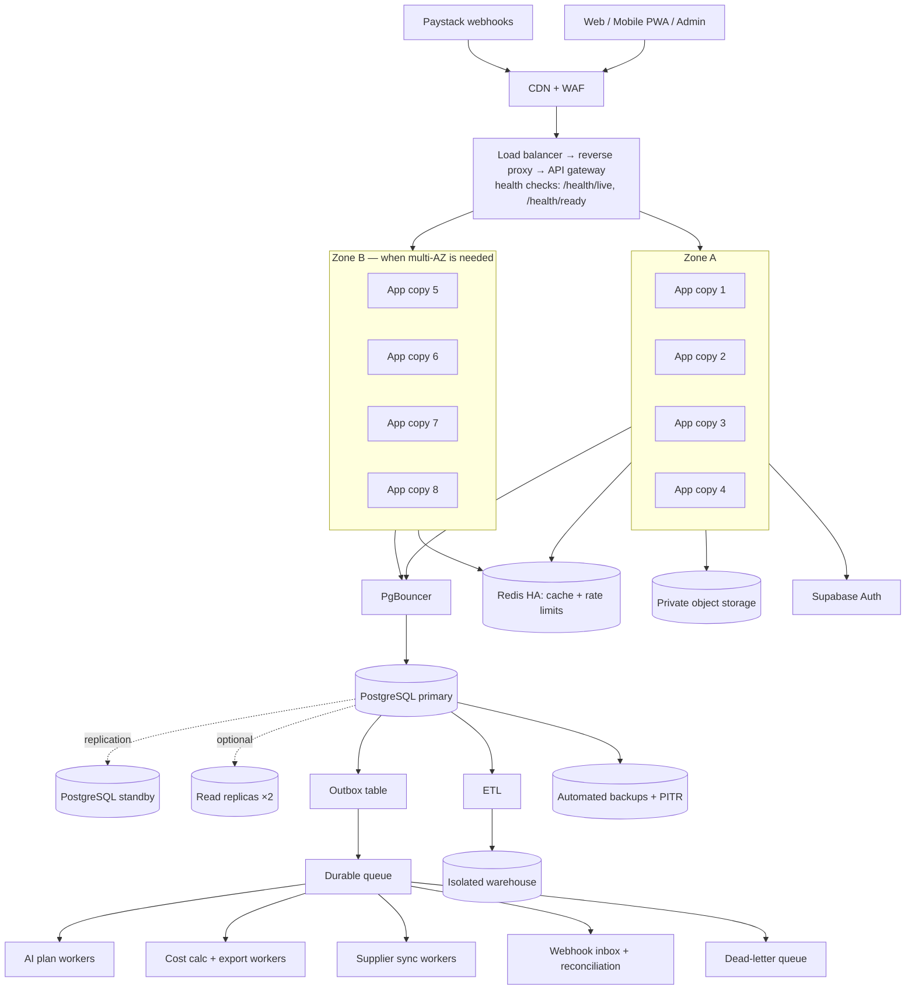

# High availability: modular monolith with backups

> **Status:** Proposed (5 Nov 2026). Target design, **not built or load-tested**. It adds a high-availability view on top of [System design v4](01-system-design-v4.md) and does not change any decision. Open items are listed in the [Decision register](../00-overview/02-decision-register.md).

## 1. In short

- KagoBuild stays a **modular monolith**: one codebase with separate modules inside (decision **A-04**). There are no microservices until measurements show a need.
- To survive failures, we run **many copies** of the same app behind a load balancer, and **every data store has a backup**.
- Heavy jobs (AI, exports, supplier sync, payment checks) run in **separate workers**. If AI breaks, login and payments keep working.
- None of this is proven yet. Load-test at **100 → 1,000 → 10,000** users at the same time first ([v4 §1.3](01-system-design-v4.md)).

### Tags used in this document

| Tag | Meaning |
|-----|---------|
| **PLANNED** | Designed in the docs, not built yet ([Project status §3](../00-overview/01-project-status.md)) |
| **DECIDE** | Open item in the [Decision register](../00-overview/02-decision-register.md) |
| **SUGGESTED** | Not in the existing docs; a recommendation that needs team agreement |
| *(no tag)* | Taken from the existing docs |

## 2. Monolith vs microservices (simple version)

| | Modular monolith (our choice) | Microservices |
|---|---|---|
| What it is | One app with all modules inside, run as many identical copies | Many small apps, each with its own deployment, talking over the network |
| If one copy crashes | Load balancer sends users to the other copies | If one service is down, the features that need it are down |
| Effort to run | Low: one build, one deploy | High: many deploys, network failures between services, tracing, data consistency |
| When to switch | Only when a measured bottleneck or separate teams justify it ([v4 §1.3](01-system-design-v4.md)) | |

## 3. Architecture

## 4. Components and their backups

### 4.1 Edge

| Part | What it does | Backup / resilience | Source |
|------|--------------|---------------------|--------|
| CDN + WAF | Serves static files fast, blocks attacks and floods | Managed service | v4 §1.1 |
| Load balancer → reverse proxy → API gateway | Sends users only to healthy copies; size limits, quotas, version routes | Can be one managed product. **SUGGESTED:** use a managed load balancer with built-in redundancy | v4 §1.1, Deployment step 7 |
| Health checks | `/health/live` and `/health/ready` | Unhealthy copies stop receiving traffic | Deployment step 8 |

### 4.2 App copies (the monolith)

| Item | Value | Source |
|------|-------|--------|
| App | Fastify 5 on Node.js 22, modular monolith; modules: auth check, projects, materials, billing, admin | v4 §1 |
| Copies | **8 to 12** (planning model) | Scalability §4 |
| Scale up when | CPU stays above 65%, p95 latency rises, too many requests in progress, DB connections near limit | Deployment SLOs |
| Not a trigger | A growing queue means **add workers**, not app copies | Scalability §4 |
| Two zones | Add a second zone **when multi-AZ availability is needed**, together with managed HA PostgreSQL | v4 §1.3 |
| DB connections | 12 per copy in the starter; add **PgBouncer** for many copies | v4 §5 |

### 4.3 Live updates

| Item | Value | Source |
|------|-------|--------|
| Method | **SSE** for AI progress (`/api/v1/generations/{jobId}/events`). WebSockets deferred to live chat | Decision A-06, v4 §2 |
| Where it runs | From the app copies. Dedicated streaming nodes only when measured traffic needs them | v4 §5 |
| On reconnect | App reads the job status from the database | v4 §2 |
| Status | **PLANNED** | Project status §3 |

### 4.4 Outbox, queue and workers (all PLANNED)

| Worker | Count (planning model) | Notes | Source |
|--------|------------------------|-------|--------|
| Outbox worker | — | Outbox table exists; worker not built. App saves job + data in one transaction; jobs may be delivered more than once, so workers must handle duplicates | Project status, v4 §5, §7 |
| AI plan generation | 20–40 | Geometry checks, retries, circuit breaker, per-user quotas | Scalability §4, v4 §5 |
| Cost calc + export (PDF/CSV) | 6–10 | | Scalability §4 |
| Supplier price sync | 4 | | Scalability §4 |
| Webhook inbox + payment reconciliation | 2+ **(SUGGESTED count)** | Paystack webhook endpoint is coded in the app; reconciliation scheduler not built | Project status, v4 §4 |
| ETL → warehouse | 1+ **(SUGGESTED count)** | Runs today on synthetic data only | Project status §2 |
| Dead-letter queue | — | Jobs that keep failing are parked for review | v4 §5 |

Workers scale on **queue age and depth**, not CPU of the app copies.

### 4.5 Data layer

| Store | Setup | If it fails | Source |
|-------|-------|-------------|--------|
| **PostgreSQL** | Managed HA: primary + standby; read replicas ×2 optional (only where slightly old data is acceptable) | Standby takes over. Data-loss / recovery target **DECIDE (A-07)**: 5 min / 1 h (baseline) or 15 min / 4 h (v4) | v4 §1.3, §7; Scalability §4 |
| **Redis** | Managed HA (primary + replicas). Cache-aside + shared rate limits. **Not** logins, payments or source of truth | Replica takes over. If fully down: app reads PostgreSQL with strict limits; payments, auth and AI requests fail safely | v4 §5, Caching doc |
| **Object storage** | Private storage for plans, drawings, exports | **SUGGESTED:** choose a plan that keeps copies in several zones | v4 §1 |
| **Supabase Auth** | Managed sign-in, tokens, admin MFA. App copies verify tokens with Supabase's public keys (JWKS) | New sign-ins fail. **SUGGESTED / to test:** signed-in users should keep working until their token expires | Decision A-03, Deployment step 2 |
| **Backups** | Automated backups, point-in-time restore (PITR), restore drills | Restore from backup | Deployment steps 1, 9 |
| **Off-site backup copy** | **SUGGESTED** | Location depends on POPIA data residency (**DECIDE: B-07**) | Decision register |
| **Data warehouse** | Isolated, so reports never slow down payments or the app | — | v4 §6 |
| **Monitoring + alerts** | 5xx errors, latency, queue age, DB saturation, Redis failures, missed webhooks, payment mismatches | — | v4 §7, Deployment step 9 |

## 5. If this fails, what happens?

| Failure | What happens |
|---------|--------------|
| One app copy crashes | Load balancer skips it; the other copies keep serving. It restarts. |
| A whole zone goes down | The other zone carries everyone and auto-scale adds copies (only if two zones are set up). |
| Load balancer node fails | Managed provider's built-in backup takes over (**SUGGESTED**). |
| Database primary fails | Standby takes over. Data loss / downtime within the target (**DECIDE A-07**, must be tested). |
| Redis fails | Replica takes over. If fully down: app reads the database with strict limits; payments and AI fail safely. |
| A worker crashes | Job is retried; the outbox can re-send it (**PLANNED**). |
| AI provider is down | Jobs wait and retry; circuit breaker; AI can be switched off with a feature flag. |
| Paystack is down | Checkout should show an error (checkout timeouts not built yet). Paystack re-sends webhooks; reconciliation checks later (**PLANNED**). |
| Supabase Auth is down | New sign-ins fail. Signed-in users should keep working until their token expires (**to test**). |
| Data is lost | Point-in-time restore from backups. |

## 6. Still to decide

| ID | Item |
|----|------|
| A-07 | Data-loss / recovery targets: 5 min / 1 h or 15 min / 4 h |
| B-07 | Data residency, retention and consent (POPIA); also decides where off-site backups may live |
| B-08 | Real load targets and uptime budget |
| — | Queue tool behind the outbox (not in the register; the baseline used BullMQ) |
| — | Whether to adopt the **SUGGESTED** items above |

## 7. How to prove it works

1. Load-test at 100, 1,000 and 10,000 users at the same time with a realistic request mix ([v4 §1.3](01-system-design-v4.md)).
2. Failure drills: kill an app copy, Redis down, database primary failover, AI provider timeout, duplicate Paystack webhooks ([v4 §1.3](01-system-design-v4.md)).
3. Restore drill from backup and measure real data loss and recovery time (for A-07).
4. Record results here and in the [Scalability](05-scalability.md) doc before claiming any capacity.
